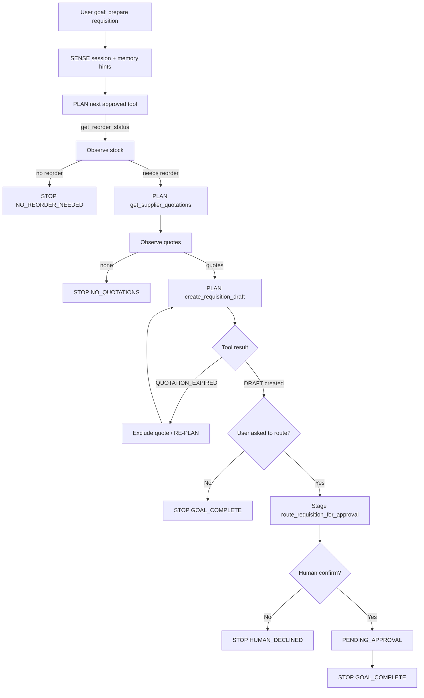

# ProcurePrep Agent Architecture (Weeks 4–6)

**Scope:** Tool calling (Week 4), bounded autonomy (Week 5), explicit state and justified memory (Week 6).

**Model / planner:** Week 4 Gemini function calling remains available. The Week 5 bounded workflow uses **direct orchestration** in `src/bounded_agent.py` so next-action choice, limits and stop reasons are inspectable without a live model.

---

## End-to-End Flow

---

## Layer Responsibilities

| Layer | Components | Role |
| :--- | :--- | :--- |
| Operational data | `data/inventory.csv`, `data/quotations.csv` | Stock and quotes |
| Deterministic gate | `get_reorder_status`, `src/procure_data.py` | Reorder math in Python |
| Tools | `src/tools.py` | Structured I/O and validation |
| Bounded agent | `src/bounded_agent.py` | Sense/Plan/Act/Observe/Stop |
| Session state | `src/agent_state.py` | One-run workflow fields |
| Persistent memory | `src/agent_memory.py` | Prefill only; 90-day retention |
| MCP-style interface | `src/mcp_interface.py` | Capability catalogue + permissions |
| Human gate | CLI / confirm callback | Required before routing |
| Draft store | `src/requisition_store.py` | DRAFT / PENDING_APPROVAL |

---

## Week 4 vs Week 5 vs Week 6

| Capability | Week 4 | Week 5 | Week 6 |
| :--- | :--- | :--- | :--- |
| Explicit tools | Yes | Same allow-list | Same + MCP wrapper |
| Model-initiated calls | Yes | Optional | Optional |
| Bounded multi-step loop | No | Yes | Yes |
| Iteration / recovery limits | Turn cap only | 8 iterations, 2 recoveries | Same |
| Inspectable session state | No | Yes | Documented state model |
| Persistent memory | No | No | Justified item history + preference |
| Human gate on routing | Yes | Retained | Retained |
